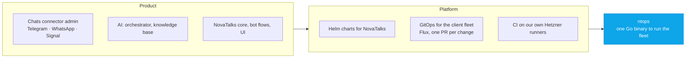

&nbsp;

### 💼 What I do at NovaIT

Product code and the infrastructure it ships on, in one team. A good part of the work is picking up code someone else started and getting it to production.

### 🌍 Open source

**[radar](https://github.com/skyhook-io/radar)** · Kubernetes UI with an MCP server. Merged: Flux and Argo CD fixes, CloudNativePG checks, system-upgrade-controller plans, pod and log fixes.

### 🛠️ Stack

  

